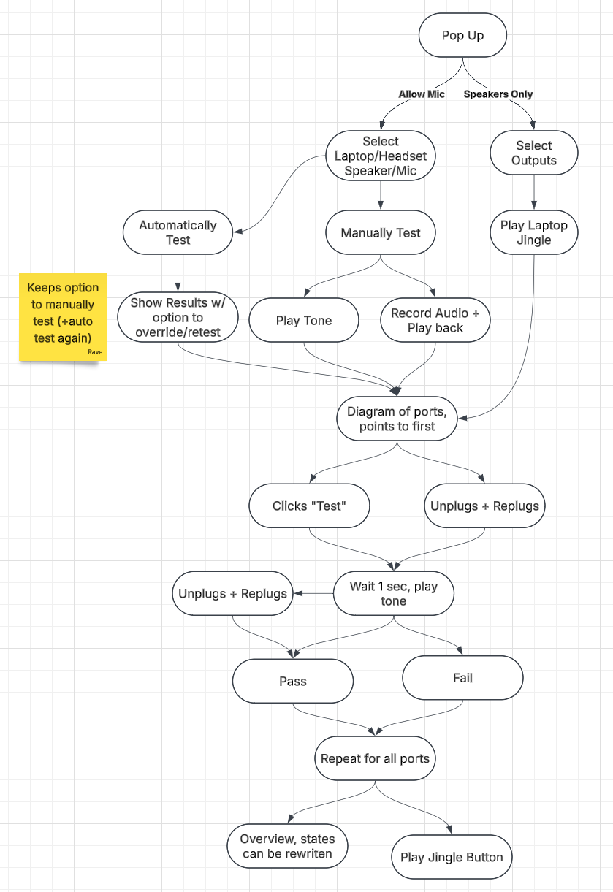

# Lenovo-Check
Built with React using Vite

## Accessibility

### Sections

#### Keyboard:

- Needs a keyboard escape hatch, try double escape in a certain window
- Make it only capture all keypresses after clicked on via enter
- Add some way to overwrite keys via keyboard (+mouse)

#### Camera:

- Needs to show errors better, especially access errors
    - NotAllowedError
    - NotFoundError

#### Audio:

- Initially a pop-up over the whole section prompts you to allow mic permissions
    - The user can opt to only test speakers if they'd like
- There is then a selector for Laptop/Headset Speakers/Mic
- There is then an option to automatically test the laptop speakers, mic, and the headset mic
    - Gives the option afterwards to override the results or retest
- It then prompts you to plug in your headset to each port with a diagram
    - When it detects the headset getting unplugged, it plays a tone a second after being plugged in again
    - It gives buttons to click pass/fail, but if you continue without failing it then it assumes a pass
    - Each port graphically shows its state, which can be overriden by clicking on it.
- View:

